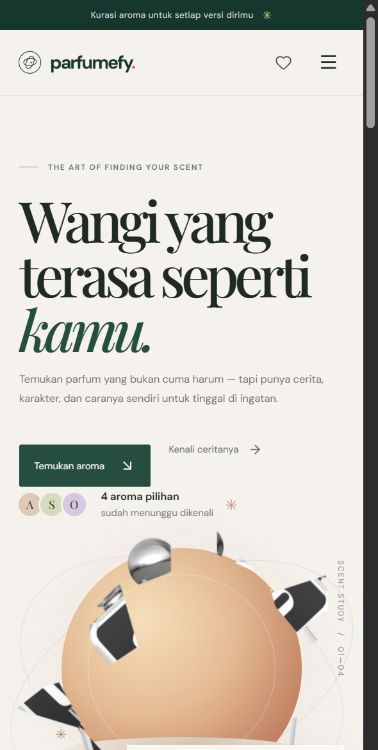

# Parfumefy

**Find the notes that feel like you.**

Parfumefy adalah pengalaman editorial untuk mengenal parfum lewat karakter, keluarga aroma, dan cerita di balik tiap wanginya. Proyek ini dibuat dengan antarmuka berbahasa Indonesia, visual responsif, dan animasi scroll yang terinspirasi dari gerak botol parfum.



## Isi proyek

- [Fitur](#fitur)
- [Pilihan parfum](#pilihan-parfum)
- [Teknologi](#teknologi)
- [Menjalankan proyek](#menjalankan-proyek)
- [Struktur folder](#struktur-folder)
- [Warna brand](#warna-brand)
- [Aset dan sumber](#aset-dan-sumber)
- [Batasan demo](#batasan-demo)

## Fitur

- **Hero scroll interaktif:** halaman pembuka dipin oleh GSAP ScrollTrigger. Afnan 9 PM mulai sebagai pecahan tak beraturan; scroll pertama menyatukannya. Scroll berikutnya memecah dan menyatukan botol parfum pilihan lain secara berurutan. Jumlah pecahan dan efek bayangan dikurangi di layar kecil agar scroll tetap ringan.
- **Koleksi parfum:** jelajahi produk dalam kartu, filter berdasarkan keluarga aroma, buka detail, dan lihat piramida notes.
- **Favorit:** simpan parfum yang ingin diingat selama sesi halaman terbuka.
- **Cerita aroma:** animasi reveal dan parallax membantu menjelaskan top notes, heart notes, dan dry down.
- **Responsif:** tata letak menyesuaikan layar ponsel dan desktop.
- **Identitas visual:** ikon botol parfum dipakai sebagai logo dan favicon PNG/ICO.

## Pilihan parfum

| Brand | Parfum | Keluarga aroma |
| --- | --- | --- |
| Afnan | 9 PM | Gourmand |
| Zimaya | Sharaf Blend | Gourmand |
| HMNS | Philea | Floral |
| Kenz × Rasasi | Hawas Frost | Fresh |

Informasi top, heart, dan base notes Hawas Frost ditampilkan sebagai belum diumumkan karena belum tersedia di sumber yang digunakan.

## Teknologi

- React 19
- Vite 8
- GSAP 3 dan ScrollTrigger
- Lucide React
- CSS

## Menjalankan proyek

**Prasyarat:** Node.js `20.19+` atau `22.12+`, serta npm.

```bash
npm install
npm run dev
```

Vite akan menampilkan alamat lokal di terminal, biasanya `http://localhost:5173`.

### Perintah lain

```bash
npm run build    # membuat build produksi di dist/
npm run preview  # melihat build produksi secara lokal
npm run lint     # menjalankan Oxlint
```

## Struktur folder

```text
.
├── public/
│   ├── favicon.ico
│   ├── favicon.png
│   ├── parfumefy-mark.png
│   └── images/              # foto produk dan cutout untuk animasi
├── src/
│   ├── App.jsx              # konten, data parfum, dan interaksi
│   ├── App.css              # tampilan, responsif, dan animasi CSS
│   ├── index.css            # gaya dasar aplikasi
│   └── main.jsx             # entry point React
├── artifacts/
│   └── afnan-first-load.png # cuplikan hero saat pertama dibuka
├── index.html
├── package.json
└── vite.config.js
```

## Warna brand

| Peran | Kode |
| --- | --- |
| Hijau utama | `#254D40` |
| Hijau gelap | `#16372D` |
| Aksen hijau muda | `#C7DE8A` |
| Latar krem | `#F5F2ED` |

Variabel warna tersedia di bagian `:root` dalam `src/App.css`.

## Aset dan sumber

Foto produk disimpan secara lokal di `public/images/` dalam format WebP yang dikompresi. Gambar cutout dipakai agar botol bisa dibagi menjadi pecahan saat animasi scroll, dengan ukuran dan efek yang disesuaikan untuk layar kecil.

| Produk | Referensi |
| --- | --- |
| Afnan 9 PM | [Halaman produk Afnan](https://india.afnan.com/products/9-pm) |
| Zimaya Sharaf Blend | [Halaman produk Zimaya](https://zimayaperfumes.com/products/sharaf-blend-100ml) |
| HMNS Philea | [Halaman produk HMNS](https://hmnsperfume.com/products/hmns-perfume-philea-100ml) |
| Hawas Frost | [Listing Hawas Frost](https://fragrance-gems.eu/products/rasasi-hawas-frost-kenz-de-rasasi-100ml) |

Gambar Philea berasal dari kanal gambar produk HMNS. Gambar Hawas Frost berasal dari listing retailer. Nama dan merek parfum adalah milik pemegang mereknya. Pastikan izin penggunaan aset gambar sebelum menerbitkan situs untuk keperluan komersial.

Logo botol pada `public/parfumefy-mark.png` dan favicon dibuat dari gambar yang diberikan untuk proyek ini. Favicon tersedia dalam format `.ico` multiukuran dan PNG.

## Batasan demo

- Favorit hanya disimpan di state halaman dan akan hilang setelah halaman dimuat ulang.
- Form newsletter hanya menampilkan konfirmasi di antarmuka; belum mengirim atau menyimpan alamat email.
- Proyek ini belum terhubung ke backend, sistem akun, atau layanan toko.
